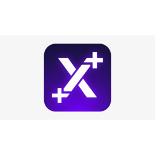

# X++ (XPlusPlus) v0.4.7
*Programming For Everyone*

**Same pseudocode. Same ease. Native VM + Decentralized Package Management + 34 Standard Libraries.**

X++ is an intent-driven language: you write **strict pseudocode** (or loose English steps for the AI mode), type one command, and it *booms*. Version 0.4.7 introduces a full **decentralized package manager** (`x install github.com/<library>`) and a massive suite of **34 standard libraries** across mathematics, web development, GUI, gaming, animations, and system utilities.

ALL standard libraries work seamlessly across all 5 RNMs: `XCOM`, `XITR`, `ZCOM`, `ZITR`, `ZJIT`.

---

## One command, that's it

```bash
# Run any X++ program
x run app.xp

# Install a package from GitHub
x install github.com/<owner>/<repo>

# List installed packages
x list
```

---

## Execution Modes (RNMs)

| RNM | Name | What it is | Needs |
|-----|------|------------|-------|
| `RNM=ZITR` | Native fast VM (default) | Stack VM over `.xbc` bytecode with NaN boxing | `xppvm` |
| `RNM=ZCOM` | Strict bytecode AOT | `.xp` → `.xbc` bytecode, verifiable/disassemblable | `xppvm` |
| `RNM=ZJIT` | Native AOT backend | `.xp` → C++ → machine code (with portable fallback) | `xppvm` |
| `RNM=XCOM` | Strict AOT (Python bytecode) | `.xp` → Python bytecode | Python 3.9+ |
| `RNM=XITR` | Fast VM (Python exec) | Fast code-object cache | Python 3.9+ |
| `RNM=ITR`  | AI intent compiler | LLM translates English steps → executable | OpenRouter key |

---

## Package Management System (XPM)

Install any library directly from its GitHub repository:

```bash
# Install library
x install github.com/user/libname
x install user/libname

# Install all project dependencies from xpp.json
x install

# Remove an installed library
x remove libname

# List local and global packages
x list

# Update libraries
x update [libname]

# Initialize a new project with xpp.json and main.xp
x init my_project
```

### In Your Code:
```xpp
use mathX
use "github.com/user/libname"

out mathX.sqrt(144)
```

---

## Standard Libraries (34 Complete Modules)

### Mathematical Libs
- **`mathX`**: Full math operations (trigonometry, hyperbolic, combinatorics, stats, constants `pi`, `e`, `tau`, `phi`, `gcd`, `lcm`, `factorial`).
- **`Xsci`**: Scipy for XPP (minimization, root finding, curve fitting, Simpson/trapezoid quad, 1D interpolation, FFT/IFFT, filters, Bessel functions, distributions).
- **`Xnum`**: Numpy for XPP (multidimensional `NDArray`, `zeros`, `ones`, `arange`, `linspace`, matrix reshaping, `dot`, `matmul`, axis aggregations).
- **`Xlin`**: Linear algebra module (determinant `det`, inverse `inv`, `solve`, `trace`, `norm`, QR, LU, eigenvalues/eigenvectors `eig`).
- **`XCAS`**: Computer algebra system (symbolic expressions, differentiation `diff`, integration `integrate`, `simplify`, equation solving `solve`).
- **`XCalculus`**: Complete calculus (limits, derivatives, partial derivatives, Jacobian, Hessian, single/double/triple integrals, gradient, divergence, curl, Laplacian).
- **`Xplotlib`**: Matplotlib for XPP (2D plots, 3D surface/wireframe, 4D animated frames, interactive GUI window, SVG output, terminal ASCII visualization).

### Web Related Libraries
- **`ScrapeX`**: Web scraping module (HTTP fetch/get/post, HTML DOM parser, CSS selector queries `#id`, `.class`, tables, links, images).
- **`XWeb`**: Full-stack web module (HTML builder tags, responsive CSS compiler, JS injection, router, static site exporter).
- **`XWview`**: Desktop webview library (display web content, load HTML/URL, execute JS, desktop window interface).

### Development Libs
- **`GraphiX`**: 2D vector & canvas graphics engine (primitives, transforms, CSS styling via `apply_css`, SVG export).
- **`XGUI`**: Desktop GUI library for beautiful interfaces (`window`, `card`, `button`, `text_input`, `slider`, themes `modern-dark`, `glassmorphism`, `neo-brutalism`, CSS/JS styling).
- **`TerminX`**: Terminal scripts & CLI UI (ANSI colors, bold/dim/italic, bordered boxes, tables, progress bars, prompts).
- **`Xin`**: Mouse and keyboard input detection (`getch`, key polling, mouse position coordinates, click listeners).
- **`GameX`**: 2D & 3D game suite with physics, collisions, camera, and asset loaders for:
  - **2D**: PNG, PSD, TGA, WebP, GIF, SVG, DDS, JSON, JPEG, ASEPRITE.
  - **3D**: FBX, OBJ, GLTF/GLB, BLEND, MAX, MAYA, USD/USDA, 3DS, COLLADA (DAE), STL.
- **`Xanmin8`**: Mathematical animation suite (Manim counterpart: `Circle`, `Square`, `Text`, `MathTex`, `Transform`, `FadeIn`, scenes & timelines).

### System & Utility Libs
Full complete XPP counterparts of:
- `os`, `sys`, `pathlib`, `shutil`, `time`, `datetime`, `random`, `json`, `csv`, `re`, `collections`, `itertools`, `functools`, `urllib`, `http`, `socket`, `unittest`, `logging`, `sqlite3`.

---

## License

GPL-3.0 – Aagastya Verma / Atom Software · r/xpplang
